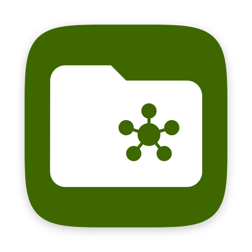
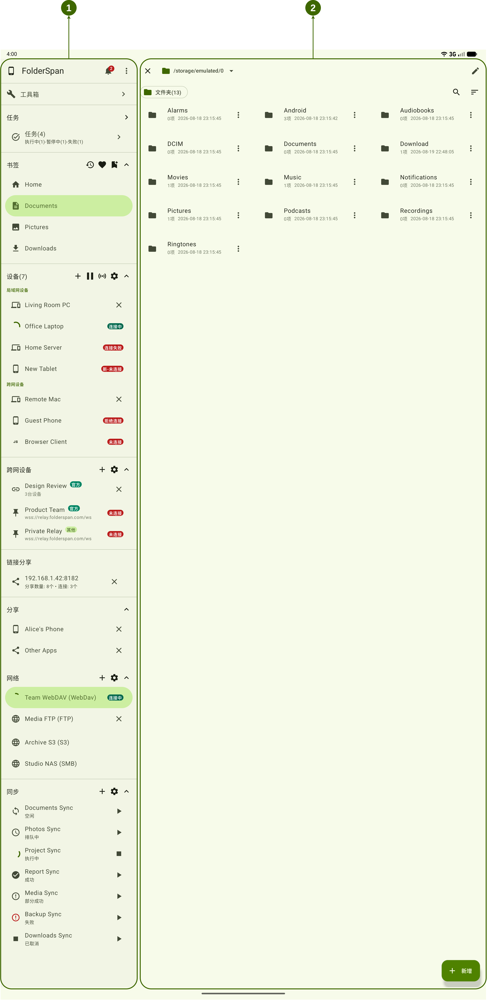
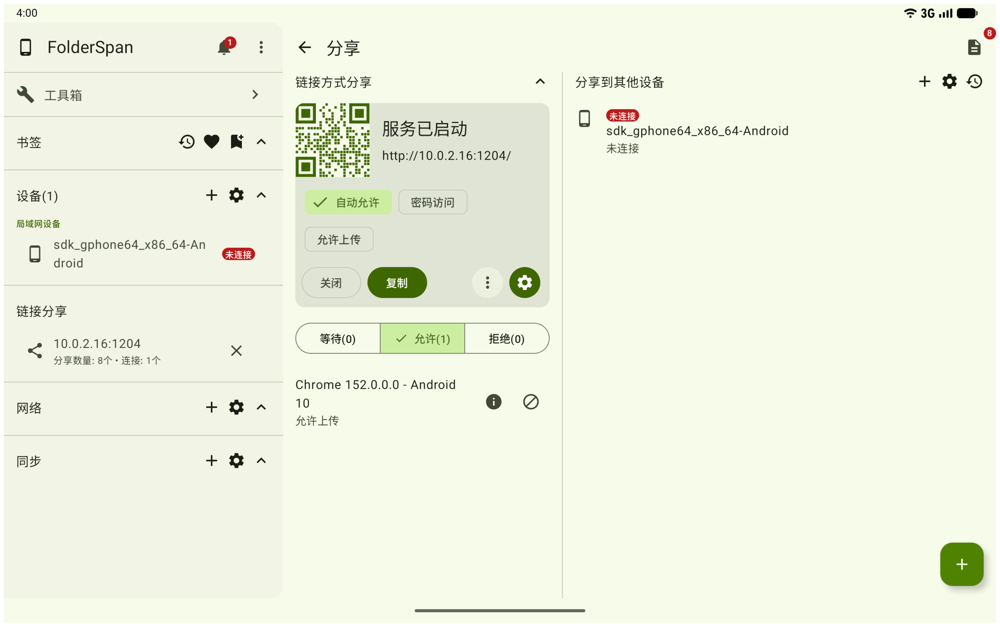
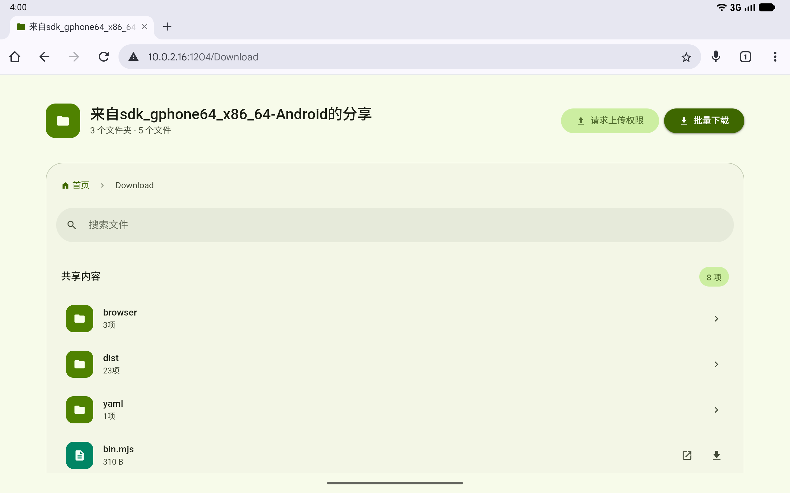

<p align="center">
  
</p>

<h1 align="center">FolderSpan</h1>

<p align="center">让文件管理保持简洁有序</p>

<p align="center">
  <a href="https://github.com/Qqv0V6ge/FolderSpan/releases/latest">下载普通版</a> ·
  <a href="#界面截图">界面截图</a> ·
  <a href="#源码运行">源码运行</a> ·
  <a href="https://github.com/Qqv0V6ge/FolderSpan/issues">问题反馈</a>
</p>

FolderSpan 是基于 Kotlin Multiplatform 与 Compose Multiplatform 的跨平台文件管理与分享工具。你可以在一个界面中浏览本机文件、访问已连接设备和网络存储，也可以通过链接分享文件，或创建文件同步任务。

本文介绍公开源码对应的普通版（`no-pro`）功能。

## 功能亮点

| 功能 | 可以做什么 |
| --- | --- |
| 文件管理 | 浏览、搜索和筛选文件，切换列表与网格视图，复制、移动、重命名和删除文件。 |
| 书签与收藏 | 为常用路径添加书签，收藏文件，并通过最近访问记录快速返回。 |
| 网络存储 | 连接 FTP、SFTP、SMB、WebDAV 和 S3 存储，统一浏览与管理远程文件。 |
| 局域网设备 | 发现并连接局域网中的设备，访问共享文件并在设备间传输。 |
| 链接分享 | 将文件或文件夹通过访问地址、二维码分享给同一局域网中的接收方，使用浏览器查看共享内容。 |
| 文件同步 | 创建和管理文件同步任务，查看任务进度与执行状态。 |
| 跨网连接 | 自行配置信令来源，通过 WebRTC 连接不同网络中的设备。 |

可用的协议、文件访问权限和原生连接能力随平台而异；Web 端访问宿主文件和网络存储需要连接 Headless Runtime。

## 界面截图

截图来自文档仓库的示例页面，实际布局和可用入口以对应平台及普通版为准。

### 文件管理首页

侧边栏集中展示书签、设备、网络和任务入口，右侧区域用于浏览文件。

<p align="center">
  
</p>

### 局域网链接分享

选择文件或文件夹后创建分享，将访问地址或二维码发送给接收方。访问期间，双方需要处于同一局域网，发送方需保持分享服务运行。

<table>
  <tr>
    <th width="50%">分享地址与二维码</th>
    <th width="50%">浏览器中的共享内容</th>
  </tr>
  <tr>
    <td></td>
    <td></td>
  </tr>
</table>

## 下载与平台支持

前往 [GitHub Releases](https://github.com/Qqv0V6ge/FolderSpan/releases/latest)，按操作系统和处理器架构选择名称中包含 **`no-pro`** 的安装包。

| 平台 / 使用方式 | 状态与选择建议 |
| --- | --- |
| Android | 已提供 APK，要求 Android 8.0（API 26）或更高版本。不确定架构时选择 `universal` APK。 |
| Windows | 已提供 x64 安装包和 ARM64 压缩包；ARM64 包解压后运行。 |
| macOS | 已提供 Apple Silicon 与 Intel 安装包，按芯片类型选择 DMG 或 PKG。 |
| Linux | 已提供 x64 与 ARM64 包，可按发行版选择 DEB、RPM、Flatpak 或 TAR.GZ。 |
| Headless Runtime | 已提供 Windows、macOS 和 Linux 的无窗口运行包，适合通过浏览器管理服务器或常开设备。首次使用推荐内置 JS 界面的 `headless-runtime-…-js-no-pro-…` 包。 |
| Web | 已提供 JS 和 Wasm 前端包。独立部署后需要连接 Headless Runtime，管理该 Runtime 所在机器的文件。 |
| iOS | 仓库包含源码与 Xcode 工程，当前发布未提供 iOS 安装包。 |

Desktop 和 Headless 发行包包含 Java Runtime，直接使用安装包无需另装 Java。Windows ARM64 包当前不支持本机原生 WebRTC。

Headless 启动后，按控制台提示打开页面并输入访问密钥。独立部署 Web 前端时，应选择与 Runtime 相同版本的 `no-pro` 包；前端与 Runtime 不同源时，需要在 Runtime 的 `FOLDERSPAN_WEB_UI_ALLOWED_ORIGINS` 中配置前端的完整来源。

Headless 提供宿主文件与连接能力，任务由浏览器页面管理；关闭页面或会话断开后，不保证任务继续运行。

## 源码运行

### 环境准备

- 安装 **JDK 17**，将 `JAVA_HOME` 指向完整 JDK。
- 使用仓库自带的 **Gradle Wrapper**，无需单独安装 Gradle。
- 安装 Android SDK Platform **37**，通过 `ANDROID_HOME` 或根目录 `local.properties` 中的 `sdk.dir` 配置 SDK 路径。工程配置包含 Android 模块，桌面与 Web 的 Gradle 配置也会涉及 Android SDK。
- iOS 开发需要 macOS、Xcode、CocoaPods 和原生依赖；下方命令用于桌面、Android 与 Web。

克隆公开主仓库：

```bash
git clone https://github.com/Qqv0V6ge/FolderSpan.git
cd FolderSpan
```

下方命令均使用 `-PincludeProMain=false` 构建普通版，无需获取私有 `proMain` 子模块。`-PfolderspanBuildType=release` 使用发布环境配置，避免依赖开发者本地服务地址。

### 桌面端

```bash
./gradlew -PincludeProMain=false -PfolderspanBuildType=release :app:desktopApp:run
```

### Android Debug APK

```bash
./gradlew -PincludeProMain=false -PfolderspanBuildType=release :app:androidApp:assembleDebug
```

APK 输出目录为 `app/androidApp/build/outputs/apk/debug/`。其中 `assembleDebug` 控制 Android 的调试构建，`folderspanBuildType` 控制应用服务环境配置。

### Web 开发服务

JavaScript：

```bash
./gradlew -PincludeProMain=false -PfolderspanBuildType=release :app:webApp:jsBrowserDevelopmentRun
```

WebAssembly：

```bash
./gradlew -PincludeProMain=false -PfolderspanBuildType=release :app:webApp:wasmJsBrowserDevelopmentRun
```

按 Gradle 输出的地址访问页面。Wasm 版本需要浏览器支持 Kotlin/Wasm 所需特性；不确定兼容性时优先使用 JS 版本。管理宿主文件时，需要配套运行 Headless Runtime。

Windows 上将上述 `./gradlew` 替换为 `.\gradlew.bat`。

## 工程结构

| 目录 | 职责 |
| --- | --- |
| `core/` | 核心文件逻辑、设备连接、网络协议、数据存储与平台适配。 |
| `app/shared/` | 各平台共享的 Compose 界面、页面与交互组件。 |
| `app/desktopApp/` | Windows、macOS、Linux 桌面入口与打包配置。 |
| `app/androidApp/` | Android 应用入口与构建配置。 |
| `app/iosApp/` | iOS 应用入口、Xcode 工程与 CocoaPods 配置。 |
| `app/webApp/` | JavaScript 与 WebAssembly 浏览器入口。 |
| `app/headlessRuntime/` | 无窗口运行时，为 Web 界面提供宿主文件与连接能力。 |

## 开源许可

普通版（`no-pro`）的自有代码采用 [Apache-2.0](LICENSE)。第三方组件保留各自许可，详见 [许可范围](LICENSING.md) 和 [第三方声明](THIRD_PARTY_NOTICES.txt)。独立的 `proMain` 子模块不在普通版授权范围内。

## 问题反馈

遇到问题或有改进建议，请提交 [GitHub Issue](https://github.com/Qqv0V6ge/FolderSpan/issues)。建议提供应用版本、操作系统、使用的平台或安装包类型、复现步骤，以及必要的截图或日志。
